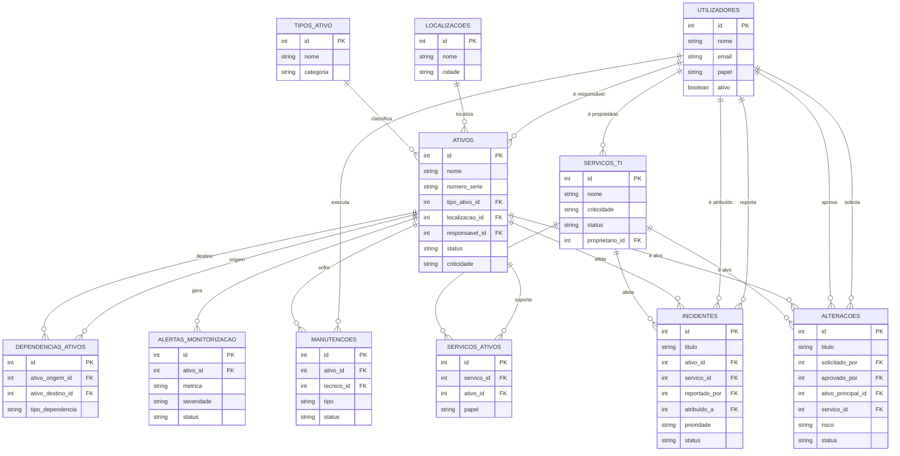

# Diagrama Entidade-Relacionamento (texto / Mermaid)

Podes copiar o código Mermaid abaixo para https://mermaid.live ou draw.io e exportar como `diagrama_er.png`.

**Cardinalidades principais:**
- Um Utilizador pode ser responsável por vários Ativos (1:N)
- Um Ativo pertence a uma Localização e a um Tipo (N:1)
- Dependências: N:N entre Ativos (através de DEPENDENCIAS_ATIVOS)
- Serviços N:N Ativos (através de SERVICOS_ATIVOS)
- Um Ativo pode ter muitos Incidentes, Manutenções e Alertas (1:N)

**Nota para o vídeo:** Explica as cardinalidades, a participação (total/parcial) e o papel da entidade associativa `dependencias_ativos` para a análise automática de impacto.
